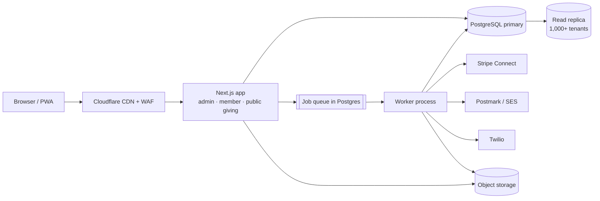
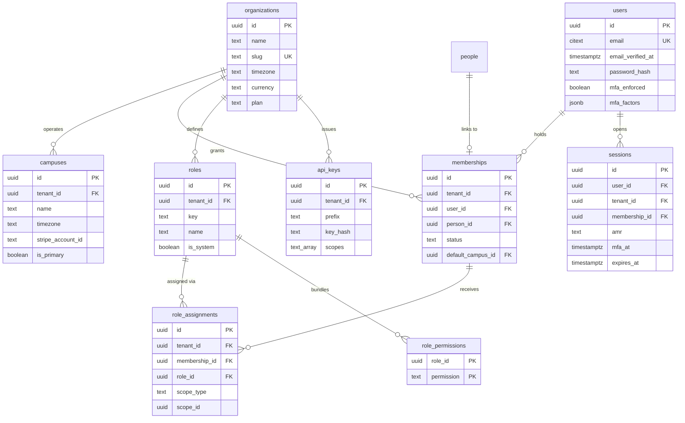
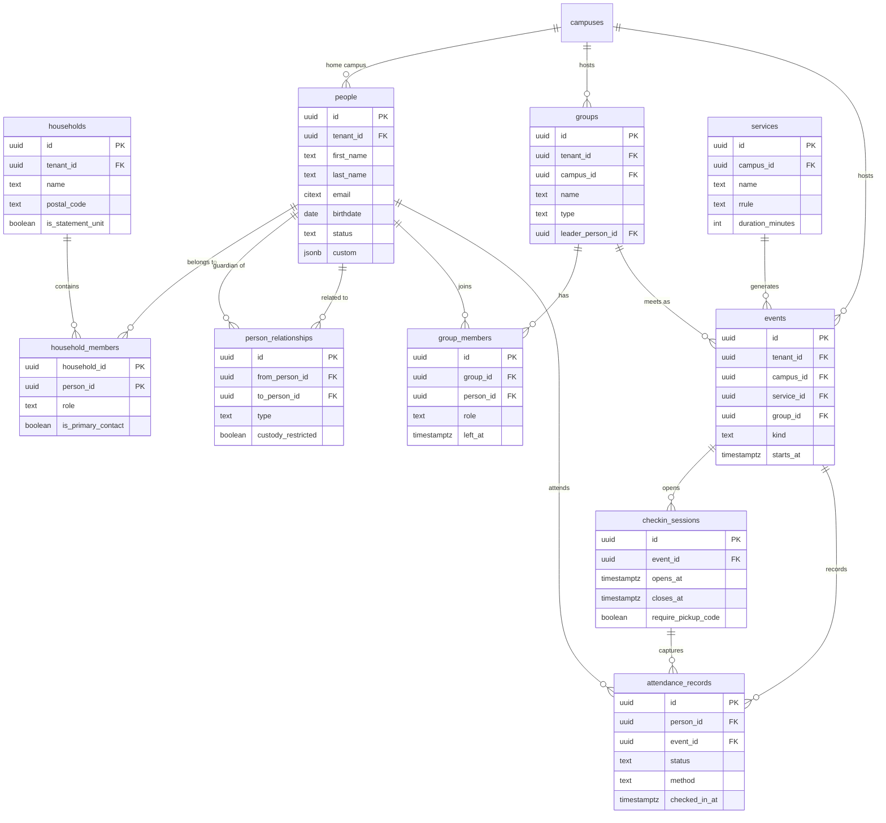
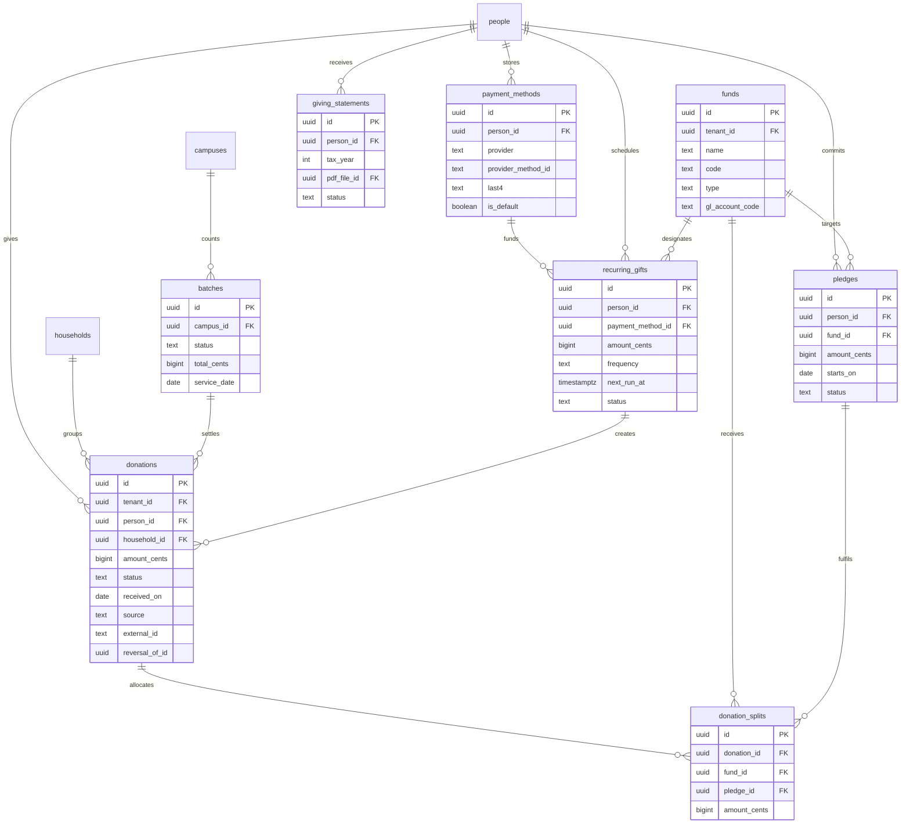

# 04 — Technical Architecture and Data Model

**What this is:** the build blueprint for a multi-tenant church management platform (ChMS): stack, tenancy, access control, schema, background processing, integrations, operations, and the decisions that are expensive to undo.

**Who reads it:** the founding engineer(s), and anyone staffing, quoting or reviewing the build.

**Scope and premises**

- Team of 2–4 engineers, comfortable in TypeScript, no dedicated SRE.
- Tenants: churches of 150–3,000 weekly attenders, single- and multi-campus, US-first (USD, US SMS, QuickBooks).
- Surfaces: staff admin web app, member/donor web experience (mobile-first), check-in kiosk mode, public giving pages, REST API.
- Out of scope for v1: native mobile apps, group chat, sermon media, payroll, child-care invoicing.
- All money figures are USD list prices at the access date, excluding payroll, support tooling and pass-through payment/SMS fees.

**Version:** v1.0 — 2026-10-29. Owner: engineering lead. Review trigger: first 100 paying churches, any tenancy change, or any change to the money model.

---

## Summary

Build a TypeScript modular monolith: one Next.js app (admin, member portal, public giving) plus a separate Node worker, PostgreSQL, and a Postgres-backed job queue. One codebase, one language, one deploy; split services only at a measured bottleneck. Tenancy is shared schema with `tenant_id` on every table, composite foreign keys, and row-level security as a backstop rather than the primary control. Members sign in passwordless; staff use SSO or password plus mandatory MFA, with TOTP/passkey required for finance. The model centres on people, not households, as the subject of attendance and giving; donations are an append-only ledger with fund splits; attendance is one row per person per event. Stripe Connect Standard accounts with direct charges keep each church as merchant of record. Infrastructure runs about $300/month at 100 churches, $2,300 at 1,000 and $14,500 at 10,000, before payment and SMS pass-through. Eight decisions are expensive to reverse; settle them before the first migration.

**Decision index**

| # | Section | Decision | Status |
|---|---|---|---|
| 1 | §1 | TypeScript modular monolith over Laravel/Rails | Recommended |
| 2 | §2 | Shared schema + RLS over schema/database per tenant | Recommended |
| 3 | §3 | Global users + memberships + scoped RBAC | Recommended |
| 4 | §4 | 40-table domain model, person-atomic | Recommended |
| 5 | §5 | Postgres job queue over Redis/BullMQ | Recommended |
| 6 | §6 | Stripe direct charges on Standard accounts | Recommended |
| 7 | §7 | Managed Postgres, containers, single region | Recommended |
| 8 | §8 | Reporting rollups from 300 tenants; warehouse only past 10,000 | Recommended |

---

## 1. Recommended stack

### 1.1 The recommendation

**TypeScript end to end, deployed as a modular monolith with two entrypoints.** Not microservices, not a separate admin SPA.

| Layer | Choice | Reason |
|---|---|---|
| Runtime | Node 22 LTS or newer | Long support, native fetch, good profiler story |
| Web | Next.js (current stable, App Router) + React | Server rendering for public giving pages, server actions for admin mutations, one component library for admin and member UI |
| Worker | Separate Node process, same packages | Statement runs and imports must not share the request lifecycle or memory limit |
| Language | TypeScript, `strict`, zod at every boundary | One schema validates forms, server actions and the public API |
| Database | PostgreSQL 17+ (managed) | RLS, JSONB, full-text search, partitioning, mature backup tooling |
| Data access | Drizzle ORM, raw SQL for reports | Typed schema, SQL escape hatch, explicit control of the session variable that drives RLS |
| Jobs | graphile-worker (Postgres-backed) | Enqueue in the same transaction as the business write; no dual-write window |
| Cache / rate limits | Redis, optional below 1,000 tenants | Only where Postgres is a poor fit: token buckets, hot caches |
| UI | Tailwind + shadcn/ui | Own the components; no design-system migration later |
| Auth | better-auth or Auth.js, wrapped by an in-house policy layer | Library handles tokens and OAuth; we own permissions |
| Files | S3-compatible object storage (Cloudflare R2) | Cheap, no egress fees, presigned uploads |
| Hosting | Containers on Fly.io or Render, managed Postgres | No Kubernetes at this team size |
| Observability | OpenTelemetry + Sentry + hosted logs/metrics | Vendor-neutral instrumentation |



### 1.2 Why this shape

- **One deployable until it hurts.** A 2–4 person team pays a high tax for network boundaries: contracts, versioning, local dev, tracing across services. A modular monolith with enforced package boundaries (ESLint `no-restricted-imports`) gives most of the isolation benefit at none of the operational cost.
- **Two entrypoints, not two apps.** `web` and `worker` share `packages/core`, so a business rule (for example "a refund creates a reversal, never an edit") exists once.
- **The extraction seams are known in advance.** Integrations live in `packages/integrations` behind interfaces; anything that talks to Stripe, Postmark, Twilio or QuickBooks can become a service later without touching domain code.
- **Server rendering matters commercially.** Public giving pages and event pages need to load fast on a phone on church wifi and be indexable. A client-rendered admin SPA would add a second auth/session implementation for no user-visible gain.

### 1.3 The serious alternative: Laravel monolith

Laravel (current release) with Filament, Postgres, Redis queues and Horizon is the honest competitor, not Rails.

| Criterion (weight) | TypeScript monolith | Laravel + Filament | Rails |
|---|---|---|---|
| Time to first paying church (25%) | 10–12 weeks | 8–10 weeks | 9–11 weeks |
| Hiring pool at sub-$90k remote (20%) | Very large | Very large | Small, and priced higher |
| One language from DB to UI (15%) | Yes | No (Blade/Livewire plus JS) | No (Hotwire plus JS) |
| Type safety across DB → API → UI (15%) | End to end (Drizzle + zod) | Partial | Partial |
| Built-in auth, MFA, queues, scheduler (10%) | Assemble from libraries | Included | Included |
| Admin CRUD scaffolding (10%) | Assemble | Filament, very fast | ActiveAdmin/Avo |
| Member-facing UI quality ceiling (5%) | High | Medium | Medium |
| **Weighted fit for this product** | **Best** | Close second | Third |

**Choose Laravel instead if** the founder is a PHP developer, or the first customer must be live in under ten weeks with one engineer. Everything else in this document still applies: the tenancy contract, permission model, schema and integration choices are framework-neutral.

**Do not choose Rails** at this team size in 2026. The framework is excellent; the hiring pool at a church-software budget is not, and Hotwire makes the member-facing experience harder to differentiate than React does.

### 1.4 What the recommended stack costs you

| Gap | Cost | Mitigation |
|---|---|---|
| No admin scaffolding | 2–3 weeks | Build one `ResourceTable` + `ResourceForm` driven by column metadata; every CRUD screen after the third is configuration |
| No built-in auth/MFA | ~1 week | better-auth covers magic links, OAuth, TOTP, passkeys; we add the policy layer |
| No built-in queue | ~2 days | graphile-worker; cron in code, advisory-lock leader |
| Type safety needs discipline | Ongoing | `drizzle-zod` generates schemas from tables; one `contracts` package shared by actions and API |
| Node memory ceilings for imports | Occasional | Streaming parsers, 1,000-row chunks, worker concurrency 2 |

Net: roughly three weeks slower than Laravel to week 1, and faster from week 12 onward because the member app, admin and API share types and components.

### 1.5 Repository layout

| Path | Contents | May import |
|---|---|---|
| `apps/web` | Next.js routes: `(admin)`, `(member)`, `(public)`, `api/v1` | core, db, auth, ui, contracts |
| `apps/worker` | Job handlers, cron, scheduler leader | core, db, integrations |
| `packages/core` | Domain services and repositories; no HTTP, no React | db, contracts |
| `packages/db` | Drizzle schema, migrations, `withTenant()` | — |
| `packages/auth` | Permission catalogue, session, policy checks | db, contracts |
| `packages/integrations` | Stripe, Postmark, SES, Twilio, QBO, Xero, Google adapters | core (interfaces only) |
| `packages/contracts` | zod schemas, API types, event payloads | — |
| `packages/ui` | Design system, form primitives, table primitives | contracts |

The import rules are enforced in CI. `core` importing `integrations` is a build failure; that is what keeps the monolith modular.

### 1.6 Time to first paying customer

| Week | Deliverable | Exit test |
|---|---|---|
| 1–2 | Tenancy skeleton, auth, people/households CRUD, audit log | Two seeded tenants cannot see each other; leak suite green |
| 3–4 | Funds, donations, batches, Stripe Connect onboarding, one-time gift, receipt email | A test gift lands in the right fund and produces a receipt |
| 5–6 | Services, events, check-in v1, groups, group rosters | A parent checks in two children and gets matching pickup codes |
| 7–8 | Email messaging, CSV import, member portal (giving history, groups) | Pilot church's 800 people imported with a duplicate report |
| 9–10 | SaaS billing, statements, role templates, backups, runbooks | Restore drill passes; first statement PDF generated |
| 11–12 | Pilot in production, fixes, onboarding checklist | First invoice paid |

With two engineers, compress weeks 1–8 by roughly 30%. With four, keep the dates and add QBO sync and the public API. To hit week 8 with one engineer, cut workflows, statements and accounting integration from v1.

---

## 2. Multi-tenancy

### 2.1 The three options

| Criterion | Shared schema + `tenant_id` + RLS | Schema per tenant | Database per tenant |
|---|---|---|---|
| Isolation strength | Logical; strong if RLS is forced | Logical; weaker tooling | Physical |
| Migration at 1,000 tenants | One migration | 1,000 migrations per release, or a loop that will partially fail | 1,000 migrations, orchestrated |
| Connection pooling | One pool | `search_path` per checkout, pooler-hostile | One pool per tenant, or a proxy |
| Cross-tenant operations (billing, support, analytics) | Trivial | Painful | Very painful |
| Per-tenant restore | Hard, needs export tooling | Easy | Easy |
| Noisy neighbour | Possible | Possible | None |
| Cost at 100 / 1,000 / 10,000 | $ / $ / $$$ | $$ / $$$ / prohibitive | $$$ / $$$$ / prohibitive |
| Onboarding a new church | Insert rows | DDL + seed | Provision instance |
| Realistic ceiling | 10,000+ tenants with partitioning and cells | Hundreds | Dozens |

### 2.2 Recommendation

**Shared schema, one primary database, `tenant_id` on every tenant-owned table, RLS forced on every one of them, composite foreign keys on money and membership edges.**

Sizing check, assuming 700 people records and 300 weekly attendance rows per church:

| Table | 100 churches | 1,000 churches | 10,000 churches |
|---|---|---|---|
| `people` (total rows) | 70k | 700k | 7M |
| `attendance_records` (rows/year) | 1.6M | 15.6M | 156M |
| `donations` (rows/year) | 300k | 3M | 30M |
| `message_recipients` (rows/year) | 2.4M | 24M | 240M |
| Database size after 3 years | ~15 GB | ~150 GB | ~1.5 TB |

Up to 1,000 churches this is an unremarkable single Postgres instance. At 10,000 it is a partitioning and operations problem, not a schema problem: `message_recipients`, `attendance_records` and `audit_log` must be partitioned, and the estate should be split into cells of roughly 3,000–5,000 tenants (§2.5). Schema-per-tenant buys nothing here and costs a migration pipeline plus a pooler workaround. Database-per-tenant is reserved for contracted isolation.

### 2.3 The implementation contract

Non-negotiable rules, because each one has a known failure mode:

1. **Every tenant-owned table has `tenant_id uuid not null`**, including join tables, and a composite index whose first column is `tenant_id`.
2. **The application role is not the table owner and has no `BYPASSRLS`.** Migrations run as `app_migrator` (owner); the app connects as `app_rw`. PostgreSQL documents that owners bypass RLS unless `FORCE` is used, and that superusers and `BYPASSRLS` roles always bypass it ([PostgreSQL documentation, Row Security Policies](https://www.postgresql.org/docs/current/ddl-rowsecurity.html), accessed 2026-10-29).
3. **`ENABLE` and `FORCE ROW LEVEL SECURITY` on every tenant table.** With RLS enabled and no policy, access is default-deny, which is the correct failure mode.
4. **Tenant context is set per transaction, never per session.** `SET LOCAL` survives PgBouncer transaction pooling; a session-level `SET` leaks the previous tenant into the next request on a reused connection.
5. **Repositories do not accept a tenant id argument.** They read it from an async context established by `withTenant()`, so a controller cannot pass the wrong one.
6. **No raw SQL outside `packages/db` and report modules.** A lint rule bans `db.execute` elsewhere.

```sql
-- Migration 0001: the tenancy primitive
create schema if not exists app;

create or replace function app.current_tenant() returns uuid
language sql stable as $$
  select nullif(current_setting('app.tenant_id', true), '')::uuid
$$;

alter table people enable row level security;
alter table people force row level security;

create policy tenant_isolation on people
  using (tenant_id = app.current_tenant())
  with check (tenant_id = app.current_tenant());
```

```ts
// packages/db/src/with-tenant.ts
export async function withTenant<T>(
  ctx: { tenantId: string; membershipId: string },
  fn: (tx: Tx) => Promise<T>,
): Promise<T> {
  return db.transaction(async (tx) => {
    await tx.execute(sql`select set_config('app.tenant_id', ${ctx.tenantId}, true)`);
    await tx.execute(sql`select set_config('app.membership_id', ${ctx.membershipId}, true)`);
    return fn(tx);
  });
}
```

**Composite foreign keys** are the second lock on the door. RLS filters rows a query can see; it does not stop a row in tenant A from pointing at a row in tenant B if the application supplies the id. Composite keys make that structurally impossible:

```sql
alter table donations
  add constraint donations_person_fk
  foreign key (tenant_id, person_id) references people (tenant_id, id);
```

Every parent table then needs `unique (tenant_id, id)`. That is one extra index per table and worth it for `donations`, `donation_splits`, `attendance_records`, `group_members`, `memberships` and `role_assignments`.

**RLS does not cover everything.** Referential integrity checks bypass row security by design (same PostgreSQL page), so a foreign-key violation can reveal that an id exists in another tenant. Map every `23503` to a generic `422 invalid reference`, never echo the constraint or the id. `TRUNCATE` and `REFERENCES` are also outside RLS.

### 2.4 Where this breaks, and what to do

| Failure mode | Symptom | Mitigation |
|---|---|---|
| A new query forgets `tenant_id` | Cross-tenant rows in a list, or an empty list | RLS backstop returns only the current tenant; leak suite fails CI |
| Session-level `SET` on a pooled connection | One church sees another's data intermittently | Only `withTenant()` may open a transaction; lint rule; integration test that reuses a connection across two tenants |
| Long report inside a tenant transaction | Pool exhaustion at 11am Sunday | Reports run on the replica, `statement_timeout = 30s`, no interactive transaction |
| Missing index with `tenant_id` first | Sequential scans as soon as one big tenant arrives | `pg_stat_user_tables` review each release; index every FK |
| Tenant bulk import | CPU spike, check-in latency | Import concurrency capped at 2, chunk size 1,000, separate worker pool |
| RLS policy drift | A new table ships without a policy | Migration test asserts every table with `tenant_id` has `relrowsecurity` and `relforcerowsecurity` |

### 2.5 Isolation path for a large multi-campus customer

Some customers will ask for a dedicated database: a 3,000-attender multi-campus church with a security questionnaire, or a denomination that wants contractual separation. The answer is a **cell architecture** with tenant routing, designed now and built on first demand.

| Phase | Trigger | Work | Effort |
|---|---|---|---|
| 0. Design for exit | Day one | No cross-tenant joins; UUIDv7 ids generated in app; `tenant_id` everywhere; composite FKs; all access through repositories; object keys prefixed `t/{tenant_id}/`; a `tenant_export` job exists from month one | Continuous, ~0 |
| 1. Export tool | First enterprise conversation | Stream NDJSON per table in FK order into object storage, with row counts and checksums | 3–5 days |
| 2. Dedicated cell | Signed contract | Provision a database, run the same migrations, import, verify counts and checksums, shadow-read for a week | 2–3 days |
| 3. Cutover | Maintenance window | Freeze writes (app-level tenant lock), final delta import, flip `tenant_routing.cell_id`, 60-minute soak, rollback = flip back | 2-hour window |
| 4. Steady state | After | Per-cell backups, staged migrations per cell, per-cell capacity dashboard, isolation priced into the contract | Ongoing, ~2 hours/month |

Design rules that make phase 3 boring:

- **Ids are globally unique and time-sortable** (UUIDv7 generated in the application, not `gen_random_uuid()`), so no sequence re-basing and no id collision across cells.
- **A control-plane table `tenant_routing(tenant_id, cell_id, dsn_secret_ref)`** lives in a small separate database that never holds tenant content. The app resolves the connection per request; today every row points at `primary`.
- **No cross-tenant foreign keys, ever.** This is also what makes the shared schema safe.
- **Do not use logical replication for the move.** It does not carry DDL, and sequence state needs separate handling; a logical export plus import is simpler and verifiable for a 50–500 MB tenant. Re-verify this on the Postgres major version you deploy.
- **Charge for isolation.** It is a permanent operational cost (separate backups, separate migration runs, separate monitoring). Price it as a platform fee, not a one-off setup fee.

An intermediate "schema-per-tenant, same database" tier is not worth building. It has the migration cost of schema-per-tenant without the isolation benefit of a separate database.

---

## 3. Auth and permissions

### 3.1 Identity model

Three nouns, deliberately separate:

- **`users`** — a login identity, global, unique by email. One human, one user, even if they serve two churches.
- **`memberships`** — binds a user to a tenant and (usually) a person record, with a status and a default campus. This is what a session activates.
- **`people`** — the pastoral record. Most people never have a user: children, deceased members, imported records, first-time guests.

Invariants:

1. A person may exist without a user; a user may exist without a person (a contractor).
2. At most one membership per `(user, tenant)` and one per `(tenant, person)`.
3. Removing a membership never deletes the person or their giving history.
4. A person can be staff at one church and a donor at another with a single login.
5. Staff accounts are invite-only. Only member-facing signup may create a user implicitly.

### 3.2 Authentication by audience

| Audience | Primary | Fallback | Notes |
|---|---|---|---|
| Members, donors | Email magic link | SMS one-time code | No password by default; password optional later if support load demands it |
| Volunteers, group leaders | Email magic link | Password | 30-day session |
| Staff | Google or Microsoft SSO when the email domain is claimed | Email + password, Argon2id | Domain claim auto-provisions and auto-deprovisions |
| Finance | SSO or password + TOTP | Passkey | MFA mandatory, SMS factors not allowed |
| Org admins | SSO + passkey preferred | TOTP | Step-up re-auth for role and billing changes |
| Check-in kiosks | Device pairing code | — | 90-day device token, campus-bound, revocable per device |
| API clients | API key, hashed at rest | OAuth2 apps later | Scoped, optionally campus-bound |

### 3.3 Magic link flow

1. `POST /auth/magic-link { email, tenantSlug? }` always returns `202`, whether or not the account exists.
2. Rate limit: 5 per hour per email, 20 per hour per IP, constant-time lookup.
3. Token: 32 random bytes, stored as SHA-256, 15-minute TTL, single use, bound to the email and optional tenant.
4. Email sent through Postmark with the tenant's branding and a plain-text fallback.
5. `GET /auth/verify?token=[redacted] consumes the token atomically (`update … where used_at is null returning`), creates a session, rotates the session id.
6. If the user has more than one membership, show a tenant chooser and remember the last choice.

Do not put the token in a URL that a mail scanner will prefetch and burn. Either require a POST confirm page, or accept a scanner-tolerant design where the token is single-use only after the confirm click.

### 3.4 MFA policy

| Scope | Required | Allowed factors | Enforcement | Step-up |
|---|---|---|---|---|
| Platform operators (us) | Yes | Hardware passkey, TOTP | Before any production access | Every production write |
| Org admin | Yes | Passkey, TOTP | 7-day grace, then login blocked | 15 minutes for roles, billing, API keys |
| Finance roles | Yes | TOTP, passkey; **no SMS** | Blocked at grant time | 15 minutes for refunds, statement sends, bank changes |
| Other staff | Yes | TOTP, passkey | 14-day grace | Not required |
| Group leaders | No | TOTP | Optional | Not required |
| Members, donors | No | Passkey | Optional | Not required; Stripe handles 3-D Secure |

SMS one-time codes are acceptable as a member convenience factor, never as a second factor for finance. SIM-swap and number-recycling attacks target exactly the demographic that church finance volunteers belong to.

### 3.5 Sessions

| Property | Staff | Member |
|---|---|---|
| Cookie | `__Host-chms_sid`; HttpOnly, Secure, SameSite=Lax, Path=/, no Domain | Same |
| Token | 256-bit random; SHA-256 stored in `sessions.id` | Same |
| Idle timeout | 12 hours | 30 days |
| Absolute lifetime | 30 days | 180 days |
| Rotation | On login, MFA, role change, password change | On login |
| Concurrent sessions | 5, oldest revoked | 10 |
| Revocation | Self-service device list; admin force-logout | Same |
| Sensitive actions | Require `mfa_at` within 15 minutes | n/a |

`amr` records how the session authenticated (`pwd`, `sso`, `magic_link`, `totp`, `passkey`); `mfa_at` records the last strong authentication. Authorisation for refunds, statement sends and role changes checks both.

### 3.6 RBAC schema

```sql
create table roles (
  id uuid primary key,
  tenant_id uuid not null references organizations(id),
  key text not null,                    -- 'finance_admin', 'campus_pastor', 'group_leader'
  name text not null,
  is_system boolean not null default false,
  created_at timestamptz not null default now(),
  unique (tenant_id, key)
);

create table role_permissions (
  role_id uuid not null references roles(id) on delete cascade,
  permission text not null,             -- 'donation:refund'; validated against the code catalogue
  primary key (role_id, permission)
);

create table role_assignments (
  id uuid primary key,
  tenant_id uuid not null references organizations(id),
  membership_id uuid not null references memberships(id) on delete cascade,
  role_id uuid not null references roles(id),
  scope_type text not null check (scope_type in ('org','campus','group')),
  scope_id uuid,
  granted_by uuid references users(id),
  granted_at timestamptz not null default now(),
  expires_at timestamptz,
  check ((scope_type = 'org' and scope_id is null)
      or (scope_type <> 'org' and scope_id is not null))
);

create unique index role_assignments_unique
  on role_assignments (membership_id, role_id, scope_type,
                       coalesce(scope_id, '00000000-0000-0000-0000-000000000000'::uuid));
```

`scope_id` is polymorphic (a campus id or a group id), so it cannot carry a foreign key. Enforce it with a `before insert or update` trigger that checks existence in the table implied by `scope_type`, and delete assignments in the same transaction when a campus or group is deleted.

Permission codes are constants in `packages/auth/permissions.ts`, not rows. A misspelled permission in a role is caught at startup and by a CI test that asserts every code in `role_permissions` exists in the catalogue. This removes a migration from the permission lifecycle and keeps code review honest.

### 3.7 Scope resolution

| `scope_type` | `scope_id` | Grants | Example role |
|---|---|---|---|
| `org` | `null` | Every campus in the tenant | Lead pastor, finance admin |
| `campus` | `campuses.id` | Rows belonging to that campus, plus org-wide reference data (funds, role templates) | Campus pastor |
| `group` | `groups.id` | That group's roster, meetings, attendance and messages | Group leader |

Resolution is `has(permission) AND scopeCovers(target)`. Because both halves are needed, the call site always passes the target: `authorize(session, 'donation:refund', { campusId })`. A permission check without a target is only valid for org-scoped resources such as funds or role templates.

Campus-scoped roles do not inherit org-level visibility of people. A campus pastor assigned to North Campus sees North Campus people, not the whole church. This is the single most common support complaint in incumbent ChMS products, in both directions; make it a per-role flag (`scope_includes_org_read`) rather than a hard-coded rule.

### 3.8 Permission catalogue

| Resource | Read | Write | Sensitive / destructive | Scope |
|---|---|---|---|---|
| People | `people:read` | `people:write` | `people:delete`, `people:merge`, `people:export` | org, campus, group |
| Households | `household:read` | `household:write` | `household:merge` | org, campus |
| Groups | `group:read` | `group:write` | `group:delete`, `group:member_manage` | org, campus, group |
| Group membership | `group_member:read` | `group_member:write` | — | group |
| Attendance | `attendance:read` | `attendance:write` | `attendance:delete` | org, campus, group |
| Check-in | `checkin:operate` | `checkin:configure` | `checkin:override` (release a child without a code) | campus |
| Donations | `donation:read` | `donation:write` | `donation:refund`, `donation:void`, `donation:export` | org, campus |
| Funds | `fund:read` | `fund:write` | `fund:archive` | org |
| Pledges | `pledge:read` | `pledge:write` | `pledge:delete` | org, campus |
| Payment methods | `payment_method:read` (masked) | — | `payment_method:detach` | org |
| Recurring gifts | `recurring_gift:read` | `recurring_gift:write` | `recurring_gift:cancel` | org, campus |
| Batches | `batch:read` | `batch:write` | `batch:post`, `batch:reopen` | org, campus |
| Statements | `statement:read` | `statement:generate` | `statement:send` | org |
| Messages | `message:read` | `message:write` | `message:send`, `message:approve` | org, campus, group |
| Volunteer roles | `volunteer:read` | `volunteer_role:write` | — | org, campus |
| Scheduling | `assignment:read` | `assignment:write` | `assignment:delete` | org, campus |
| Workflows | `workflow:read` | `workflow:write` | `workflow:activate` | org |
| Reports | `report:read` | — | `report:giving_detail` (individual-level giving) | org, campus |
| Settings | `settings:read` | `settings:write` | `settings:billing` | org |
| Users and roles | `user:read` | `user:invite` | `role:assign`, `role:manage` | org, campus |
| Audit log | `audit:read` | — | — | org |
| API keys | `api_key=[redacted] | `api_key=[redacted] | `api_key=[redacted] | org |
| Custom fields | `custom_field:read` | `custom_field:write` | `custom_field:delete` | org |
| Imports | `import:read` | `import:run` | `import:rollback` | org |

`report:giving_detail` is deliberately separate from `donation:read`. Most churches want staff to see that giving is up 6% without seeing that a specific family stopped giving. Enforce it in the serializer, not the UI.

### 3.9 Seeded role templates

| Template | Scope | Key permissions | Typical holder |
|---|---|---|---|
| Org owner | org | Everything, including `settings:billing` | Senior pastor, executive pastor |
| Org admin | org | Everything except billing | Operations director |
| Campus pastor | campus | `people:read`, `group:*`, `attendance:read`, `report:read`, `message:*` | Campus lead |
| Ministry lead | campus | `people:read`, `group:write`, `checkin:configure`, `volunteer:*` | Kids or worship lead |
| Group leader | group | `group:read`, `group_member:read`, `attendance:write`, `message:send` | Small-group leader |
| Finance admin | org | `donation:*`, `batch:post`, `statement:*`, `report:giving_detail`, `fund:read` | Treasurer |
| Finance viewer | org | `donation:read`, `batch:read`, `statement:read`, `report:read` | Bookkeeper |
| Check-in volunteer | campus | `checkin:operate`, `people:read` (name, photo, allergies only) | Sunday volunteer |
| Communications | org | `message:*`, `people:read`, `group:read` | Comms coordinator |
| Auditor | org | All `*:read`, `audit:read` | External accountant |

### 3.10 Enforcement layers

| Layer | Stops | Implemented in |
|---|---|---|
| Route guard | Unauthenticated requests, missing permission | Middleware and every server action |
| Scope filter | Wrong-campus access | Repository query builder, using the session's scope set, never client input |
| Row-level security | Missing tenant filter | Postgres policy |
| Field projection | Seeing amounts or notes you may not see | Serializer per audience |
| Step-up auth | Refund, statement send, role change, bank change | `mfa_at` check in the handler |
| Audit | Repudiation | `audit_log` write in the same transaction |

### 3.11 Edge cases worth designing now

- **Staff who are also donors.** One person row, one membership; the admin app never shows their own giving, and the member portal does. Do not create a second person record for the staff member.
- **Group leaders** see name, photo, phone and allergy notes for their own group only. Not addresses, not giving, not household relationships.
- **Campus pastors** get aggregate giving by default; individual detail requires `report:giving_detail`.
- **Separation of duties in finance.** A batch created by one user above a configurable threshold must be posted by another with `batch:post`. Implement with `batches.created_by` plus a pending state; do not add an approvals table in v1.
- **Children turning 18.** A nightly job flags people whose 18th birthday passed, expires guardian relationships, and opens a review task for the admin.
- **Merging duplicate people.** Repoint every foreign key in one transaction, set `merged_into_id`, write an `audit_log` entry containing both snapshots, and keep the loser row soft-deleted for 30 days. Merge is the one operation that is genuinely hard to reverse; require `people:merge` and show a preview of affected donations, attendance and group memberships.

---

## 4. Core data model

### 4.1 Conventions

| Rule | Decision |
|---|---|
| Primary keys | UUIDv7, generated in the application; time-sortable, shard-safe, index-friendly |
| Tenant key | `tenant_id` on every tenant-owned table, first column of every composite index |
| Referential integrity | Composite FKs `(tenant_id, x_id)` on money, membership and attendance edges; plain FKs elsewhere |
| Money | `amount_cents bigint` plus `currency char(3)`. No floats, no negative donations; corrections are reversals |
| Time | `timestamptz` in UTC; `date` for service and received dates; `organizations.timezone` (IANA) decides day boundaries |
| Soft delete | `deleted_at` on `people`, `groups`, `messages`, `files`. Money and attendance are never deleted |
| Naming | `snake_case`, plural tables, singular columns, `_id` suffix |
| Enums | Postgres enum for stable sets (donation status), `text` + `check` for sets that will grow (event kind) |
| Audit | Every write to money, permissions and people goes through the audit service in the same transaction |
| PII | Email lower-cased, phone in E.164; no PII in logs or error messages |

### 4.2 Table catalogue (40 domain tables)

**Tenancy and access**

| # | Table | Purpose | Key columns |
|---|---|---|---|
| 1 | `organizations` | Tenant root; billing and policy owner | `id`, `name`, `slug` (unique), `timezone`, `currency`, `locale`, `plan`, `stripe_customer_id`, `trial_ends_at`, `billing_email`, `data_region`, `settings jsonb`, `created_at` |
| 2 | `campuses` | Physical or online location | `id`, `tenant_id`, `name`, `code`, `address jsonb`, `timezone`, `service_times jsonb`, `stripe_account_id`, `charges_enabled`, `payouts_enabled`, `is_primary`, `deleted_at` |
| 3 | `users` | Global login identity | `id`, `email citext` (unique), `email_verified_at`, `password_hash`, `mfa_enforced`, `mfa_factors jsonb`, `status`, `last_login_at`, `failed_attempts`, `locked_until` |
| 4 | `memberships` | User ↔ tenant ↔ person | `id`, `tenant_id`, `user_id`, `person_id`, `status`, `default_campus_id`, `invited_by`, `joined_at`; unique `(tenant_id, user_id)`, unique `(tenant_id, person_id)` |
| 5 | `sessions` | Server-side sessions | `id` (hash), `user_id`, `tenant_id`, `membership_id`, `amr`, `mfa_at`, `ip inet`, `user_agent`, `created_at`, `last_seen_at`, `expires_at`, `revoked_at` |
| 6 | `roles` | Tenant-defined role | `id`, `tenant_id`, `key`, `name`, `description`, `is_system`; unique `(tenant_id, key)` |
| 7 | `role_permissions` | Permission bundle | `role_id`, `permission`; PK `(role_id, permission)` |
| 8 | `role_assignments` | Grant with scope | `id`, `tenant_id`, `membership_id`, `role_id`, `scope_type`, `scope_id`, `granted_by`, `granted_at`, `expires_at` |
| 9 | `api_keys` | Hashed API and calendar credentials | `id`, `tenant_id`, `name`, `prefix`, `key_hash`, `scopes text[]`, `campus_ids uuid[]`, `created_by`, `last_used_at`, `expires_at`, `revoked_at` |

**People**

| # | Table | Purpose | Key columns |
|---|---|---|---|
| 10 | `people` | Person record; subject of attendance and giving | `id`, `tenant_id`, `first_name`, `last_name`, `preferred_name`, `email citext`, `phone`, `birthdate`, `gender`, `status`, `membership_status`, `home_campus_id`, `first_visit_at`, `last_activity_at`, `photo_file_id`, `merged_into_id`, `custom jsonb`, `search tsvector`, `deleted_at` |
| 11 | `households` | Address and statement grouping | `id`, `tenant_id`, `name`, `address_line1`, `address_line2`, `city`, `region`, `postal_code`, `country`, `phone`, `campus_id`, `head_person_id`, `is_statement_unit` |
| 12 | `household_members` | Membership in a household | `household_id`, `person_id`, `role` (head/spouse/child/other), `is_primary_contact`; PK `(household_id, person_id)` |
| 13 | `person_relationships` | Guardianship, spouse, emergency contact | `id`, `tenant_id`, `from_person_id`, `to_person_id`, `type`, `is_guardian`, `custody_restricted`, `notes` |
| 14 | `custom_field_definitions` | Per-tenant schema extension | `id`, `tenant_id`, `entity` (person/group/event/donation), `key`, `label`, `data_type`, `options jsonb`, `required`, `searchable`, `show_in_list`, `archived_at`; unique `(tenant_id, entity, key)` |

**Groups and gatherings**

| # | Table | Purpose | Key columns |
|---|---|---|---|
| 15 | `groups` | Small group, class, team, ministry | `id`, `tenant_id`, `campus_id`, `name`, `type`, `description`, `leader_person_id`, `meeting_day`, `meeting_time`, `location_text`, `capacity`, `is_open`, `status`, `custom jsonb` |
| 16 | `group_members` | Roster over time | `id`, `tenant_id`, `group_id`, `person_id`, `role`, `status`, `joined_at`, `left_at` |
| 17 | `services` | Recurring service pattern | `id`, `tenant_id`, `campus_id`, `name`, `rrule`, `duration_minutes`, `default_location_text`, `checkin_enabled`, `is_active`, `starts_on`, `ends_on` |
| 18 | `events` | A concrete occurrence: service, group meeting, class, one-off | `id`, `tenant_id`, `campus_id`, `service_id`, `group_id`, `name`, `kind`, `starts_at`, `ends_at`, `room_text`, `capacity`, `checkin_enabled`, `checkin_opens_at`, `checkin_closes_at`, `status`, `created_by` |
| 19 | `checkin_sessions` | A check-in window for an event | `id`, `tenant_id`, `event_id`, `name`, `opens_at`, `closes_at`, `mode` (kiosk/self/roster), `require_pickup_code`, `kiosk_token_hash`, `closed_at`, `created_by` |
| 20 | `attendance_records` | One row per person per event | `id`, `tenant_id`, `person_id`, `event_id`, `checkin_session_id`, `status`, `method`, `checked_in_at`, `checked_out_at`, `checked_in_by`, `pickup_code_hash`, `first_time`, `notes` |

**Giving**

| # | Table | Purpose | Key columns |
|---|---|---|---|
| 21 | `funds` | Accounting bucket | `id`, `tenant_id`, `name`, `code`, `type` (general/designated/restricted/building/missions), `is_tax_deductible`, `gl_account_code`, `goal_cents`, `is_active`, `sort_order` |
| 22 | `donations` | Immutable gift header | `id`, `tenant_id`, `person_id`, `household_id`, `batch_id`, `recurring_gift_id`, `amount_cents`, `currency`, `method`, `status`, `received_on date`, `source`, `external_id`, `stripe_payment_intent_id`, `fee_cents`, `net_cents`, `check_number`, `memo`, `idempotency_key`, `reversal_of_id`, `created_by` |
| 23 | `donation_splits` | Fund (and pledge) allocation | `id`, `tenant_id`, `donation_id`, `fund_id`, `pledge_id`, `amount_cents` |
| 24 | `pledges` | Commitment to a campaign | `id`, `tenant_id`, `person_id`, `household_id`, `fund_id`, `campaign`, `amount_cents`, `frequency`, `starts_on`, `ends_on`, `status`, `notes` |
| 25 | `payment_methods` | Tokenised method; never PAN | `id`, `tenant_id`, `person_id`, `provider`, `provider_method_id`, `type` (card/ach/bank), `brand`, `last4`, `exp_month`, `exp_year`, `is_default`, `status` |
| 26 | `recurring_gifts` | Schedule and state machine | `id`, `tenant_id`, `person_id`, `payment_method_id`, `fund_id`, `amount_cents`, `frequency`, `anchor_day`, `next_run_at`, `status`, `stripe_subscription_id`, `failure_count`, `last_failure_at`, `started_on`, `canceled_at` |
| 27 | `batches` | Deposit or offering batch | `id`, `tenant_id`, `campus_id`, `name`, `kind`, `service_date`, `status` (open/posted/closed), `total_cents`, `deposit_account`, `external_ref`, `created_by`, `posted_by`, `posted_at` |
| 28 | `giving_statements` | Annual or quarterly statement | `id`, `tenant_id`, `person_id`, `household_id`, `tax_year`, `kind`, `total_cents`, `pdf_file_id`, `status`, `generated_at`, `sent_at`, `message_id` |

**Communications and volunteers**

| # | Table | Purpose | Key columns |
|---|---|---|---|
| 29 | `messages` | Email or SMS campaign or transactional send | `id`, `tenant_id`, `channel`, `subject`, `body_html`, `body_text`, `from_name`, `from_address`, `status`, `audience jsonb`, `scheduled_at`, `sent_at`, `campus_id`, `template_key`, `created_by` |
| 30 | `message_recipients` | Per-recipient delivery state | `id`, `tenant_id`, `message_id`, `person_id`, `address`, `status`, `provider_message_id`, `sent_at`, `delivered_at`, `error_code`, `cost_cents` |
| 31 | `communication_preferences` | Opt-in state per channel and category | `id`, `tenant_id`, `person_id`, `channel`, `category`, `opted_in`, `source`, `updated_at`; unique `(person_id, channel, category)` |
| 32 | `volunteer_roles` | A serving position | `id`, `tenant_id`, `campus_id`, `name`, `team`, `description`, `requires_background_check`, `min_age`, `is_active` |
| 33 | `assignments` | Person scheduled to a role | `id`, `tenant_id`, `volunteer_role_id`, `person_id`, `event_id`, `starts_at`, `ends_at`, `status`, `notes` |

**Workflows and platform**

| # | Table | Purpose | Key columns |
|---|---|---|---|
| 34 | `workflows` | Automation definition | `id`, `tenant_id`, `name`, `trigger_type`, `trigger_config jsonb`, `steps jsonb`, `is_active`, `version`, `created_by` |
| 35 | `workflow_runs` | Execution state | `id`, `tenant_id`, `workflow_id`, `subject_type`, `subject_id`, `status`, `current_step`, `started_at`, `finished_at`, `error`, `idempotency_key` |
| 36 | `audit_log` | Append-only actor/action record | `id`, `tenant_id`, `actor_membership_id`, `actor_type`, `action`, `entity_type`, `entity_id`, `before jsonb`, `after jsonb`, `ip`, `user_agent`, `request_id`, `created_at` |
| 37 | `files` | Object metadata | `id`, `tenant_id`, `owner_type`, `owner_id`, `kind`, `storage_key`, `content_type`, `byte_size`, `checksum`, `visibility`, `uploaded_by`, `deleted_at` |
| 38 | `import_jobs` | Import and migration runs | `id`, `tenant_id`, `kind`, `source`, `file_id`, `mapping jsonb`, `status`, `stats jsonb`, `import_batch_id`, `started_at`, `finished_at`, `created_by` |
| 39 | `webhook_endpoints` | Outbound subscriptions | `id`, `tenant_id`, `url`, `secret_hash`, `events text[]`, `is_active`, `description`, `last_success_at`, `failure_count` |
| 40 | `webhook_events` | Inbound and outbound event log | `id`, `tenant_id`, `direction`, `provider`, `provider_event_id`, `endpoint_id`, `event_type`, `payload jsonb`, `status`, `attempts`, `last_error`, `received_at`, `processed_at` |

### 4.3 ERD







### 4.4 Constraints you must actually create

1. `unique (tenant_id, id)` on every table used as a composite FK target.
2. Composite FKs on `donations`, `donation_splits`, `attendance_records`, `group_members`, `memberships`, `role_assignments`.
3. `unique (tenant_id, event_id, person_id)` on `attendance_records`.
4. `unique (tenant_id, source, external_id)` on `donations` where `external_id is not null`.
5. `unique (tenant_id, idempotency_key)` on `donations` where `idempotency_key is not null`.
6. Deferred constraint trigger: `sum(donation_splits.amount_cents) = donations.amount_cents` at commit.
7. `check (amount_cents > 0)` on `donations` and `donation_splits`; `check (currency = upper(currency))`.
8. `unique (group_id, person_id) where left_at is null` on `group_members`.
9. `unique (provider, provider_event_id) where direction = 'inbound'` on `webhook_events`.
10. **No unique index on `people.email`.** Families share an address, parents use their own for a child's record, and imported data is messy. Uniqueness is a merge recommendation, not a constraint.

### 4.5 Index rules

| Rule | Reason |
|---|---|
| Every composite index leads with `tenant_id` | Tenant pruning; RLS adds the same predicate |
| `(tenant_id, created_at desc)` for list screens | Stable keyset pagination |
| Partial indexes `where deleted_at is null` | Smaller, hotter indexes |
| GIN on `people.search` (`tsvector`) and on `custom jsonb_path_ops` | Name search and custom-field filters |
| BRIN on `created_at` for append-only tables above 100M rows | Cheap range pruning for audit and message logs |
| Maximum six indexes per table | `donations` is write-heavy; every index is write amplification |
| Drop unused indexes quarterly | `pg_stat_user_indexes.idx_scan = 0` |

### 4.6 Custom fields: definitions plus JSONB, not EAV

`custom_field_definitions` holds the per-tenant schema. Values live in a `custom jsonb` column on `people`, `groups`, `events` and `donations`, validated on write against a per-tenant zod schema compiled from the definitions and cached for five minutes.

| Option | Read cost for a 5,000-person list | Type safety | Schema change | Verdict |
|---|---|---|---|---|
| EAV (`custom_field_values` rows) | 8 fields × 5,000 people = 40,000 joins per screen | None without casting | Insert rows | Rejected |
| `ALTER TABLE` per tenant | Fast | Full | DDL locks, thousands of columns | Rejected |
| JSONB on the entity | One row, one GIN index when needed | Validated by zod at the edge | Insert a definition row | **Chosen** |

When a customer needs to filter or sort by a custom field across more than ~100k rows, add `custom_field_index(entity_type, entity_id, field_key, value_text, value_num, value_date)` maintained by trigger, and only for definitions marked `searchable`. Do not build it on day one.

### 4.7 Three decisions that are expensive to reverse

**1. The person is the atomic subject; the household is a grouping.**
Every donation, attendance record and group membership points at a person. `households` exists for addresses, statements and "family" views, with `is_statement_unit` deciding whether the year-end statement is per person or per household. The alternative, keying gifts to a household, looks simpler for a married couple and collapses on the first divorce, the first adult child who gives separately, and the first anonymous cash gift. Reversing it means re-attributing every historical gift, reissuing statements, and explaining the change to donors. Estimated cost: 4–8 weeks plus a donor-visible correction.

**2. Money is an append-only ledger with fund splits.**
A posted donation is never edited. Corrections are a new row with `reversal_of_id`; refunds reduce net without changing the original amount; a bounced check is a reversal plus a fee line. Fund allocation lives only in `donation_splits`, so one gift can span general and building funds, and a deferred trigger guarantees the splits sum to the header. Fees are recorded (`fee_cents`, `net_cents`) but never netted into the gift, because the donor's statement must show what they gave, not what the church received.
If you allow in-place edits, you lose the ability to answer "what did we tell this donor in January" and you cannot support an audit. Reversing this is a reporting rewrite plus a data reconstruction project.

**3. Tenant key and id strategy: UUIDv7, `tenant_id` everywhere, composite FKs.**
Adding `tenant_id` to a 400 GB table later requires a full rewrite with an exclusive lock, and every query, index and unique constraint changes with it. Choosing integer sequences now means a re-basing exercise at the first isolated cell. The composite FKs are what make cross-tenant leakage structurally impossible rather than merely unlikely. Cost to reverse at 1,000 tenants: 3–6 weeks with downtime risk.

**Honourable mention: attendance grain.** One row per person per event, with `status` covering present, absent, excused and late. The tempting shortcut is to store only present rows and infer absence from the roster, but rosters change: people leave groups, guests attend once, a family moves campuses. Historical absence then silently rewrites itself. Write `absent` rows when a session closes and the history stays true. Cost to reverse: the historical absence data is simply gone.

### 4.8 Deliberately deferred

| Table | Why not now | Trigger to build |
|---|---|---|
| `custom_field_index` | JSONB + GIN is enough below 100k rows per field | A customer filters by custom field at scale |
| `message_events` | Recipient status covers v1 reporting | Open/click analytics becomes a sales requirement |
| `payouts` | Stripe payout ids stored on donations and batches | Finance asks for payout reconciliation screens |
| `tags` / `taggings` | `custom jsonb` and groups cover segmentation | Segment builder ships |
| `tasks` | Workflow runs create notifications, not task records | Staff ask for a task inbox |
| `availability` | Scheduling is assignment-first | Volunteer self-scheduling ships |
| `subscriptions` (our billing) | Plan fields on `organizations` plus Stripe subscription id | Self-serve plan changes and metering |

---

## 5. Cross-cutting concerns

### 5.1 Jobs and schedulers

**Queue: Postgres, not Redis.** graphile-worker stores jobs as rows, so a job can be enqueued inside the same transaction as the donation it belongs to. With Redis, the commit can succeed and the enqueue fail, and the gift is never receipted. Throughput needs are modest: tens of jobs per second at 10,000 churches, bursting into the hundreds on Sunday morning, against a Postgres queue that handles thousands.

| Job | Trigger | Cadence / limit | Idempotency key | Notes |
|---|---|---|---|---|
| `absence_detect` | Check-in session closes, or roster submitted | Per event, within 5 minutes | `absence:{event_id}` | Writes `absent` rows for expected people, then fires absence workflows |
| `event_materialise` | Weekly, plus on service edit | 8 weeks ahead | `evt:{service_id}:{date}` | Generates occurrences from `rrule`, DST-safe |
| `attendance_rollup` | Nightly | 02:00 tenant local | `rollup:{tenant}:{date}` | Daily per-campus and per-service totals |
| `giving_rollup` | Nightly | 02:30 tenant local | `giving_rollup:{tenant}:{date}` | Fund and campus totals |
| `statement_generate` | January window, or on demand | 10 tenants/minute aggregate, workers scale | `statement:{tenant}:{year}` | Fan-out per person; PDF to object storage |
| `recurring_gift_charge` | Scheduler scan | Every 15 minutes | `rg:{id}:{scheduled_for}` | Off-session PaymentIntent on the saved method |
| `dunning` | `payment_intent.payment_failed` | T+1, T+3, T+7 | `dunning:{donation_id}:{attempt}` | Then `past_due`, notify donor and finance |
| `stripe_reconcile` | Daily | 03:00 UTC | `recon:{date}` | Compares balance transactions with donations |
| `webhook_deliver` | Event insert | Continuous, 6 attempts | `wh:{event_id}` | Backoff 1m, 5m, 30m, 2h, 6h, 24h, then dead-letter |
| `import_chunk` | Import start | 1,000 rows per chunk, concurrency 2 | `import:{job_id}:{chunk}` | Streaming parse, per-row error capture |
| `export_tenant` | Admin or contract request | On demand | `export:{tenant}:{request_id}` | NDJSON per table plus checksums |
| `purge_soft_deleted` | Nightly | 03:30 | `purge:{date}` | 30-day retention, then hard delete |
| `session_gc`, `idempotency_gc` | Nightly | 04:00 | `gc:{date}` | Bounded deletes in batches |

Scheduler mechanics:

- One leader elected with `pg_try_advisory_lock(hashtext('scheduler'))`; every worker can be a candidate, exactly one runs cron.
- Cron expressions are code, not database rows, so a deploy and a schedule cannot drift.
- Per-tenant schedules store local time plus timezone and are converted to UTC on each tick. Test the spring-forward gap explicitly: 02:30 does not exist on one day a year, and a naive scheduler either skips or double-runs that day.
- Missed runs are caught up on startup with a `missed_run` flag, not silently skipped. A worker outage at 02:00 must not lose a day of rollups.
- Every handler is idempotent and safe to run twice. That is the requirement, not a nice-to-have.

### 5.2 Idempotency

**Inbound webhooks (Stripe, Postmark, Twilio):**

1. Verify the signature before parsing the body; reject with `400` and log the provider and timestamp only.
2. `insert into webhook_events (provider, provider_event_id, …) on conflict (provider, provider_event_id) do nothing returning id`.
3. If no row was returned, the event is a duplicate: return `200` immediately.
4. Otherwise enqueue processing and return `200` in under two seconds. Never do the work inline; providers time out and retry, which multiplies the problem.
5. The handler re-reads the provider object (do not trust the payload for money) and writes in one transaction.
6. Failed events stay `failed` with `last_error`; a support screen can replay them, and replay uses the same dedupe path.

**Outbound API:** `Idempotency-Key` header on every `POST` and `PATCH`. Store `(tenant_id, key, endpoint, request_hash, response_status, response_body, expires_at)` in `idempotency_keys` for 24 hours. Same key with a different body returns `409`; same key returns the stored response. This table is infrastructure, not part of the 40-table domain count, alongside the job queue and migration tables.

**Jobs:** graphile-worker's unique `job_key` covers the common case; for multi-step work the handler also checks state (`workflow_runs.idempotency_key`, `donations.idempotency_key`) before acting.

### 5.3 Files and photos

| Concern | Decision |
|---|---|
| Storage | S3-compatible bucket (Cloudflare R2), private; no public objects |
| Key scheme | `t/{tenant_id}/{kind}/{uuid}.{ext}` — tenant prefix enables export and deletion by prefix |
| Upload | Presigned `PUT`, 5-minute expiry, content-type and size enforced server-side after upload |
| Limits | 10 MB photos, 25 MB imports, 5 MB statement PDFs |
| Images | `sharp` pipeline to 128/512/1024 WebP; **strip EXIF**, which contains GPS coordinates of children's photos |
| Serving | Short-lived signed `GET` (15 minutes) or signed CDN cookies for branded pages |
| Scanning | Import files scanned (ClamAV sidecar or a scanning API); macros rejected; CSV formula injection neutralised on export |
| Retention | Statements 7 years (finance), imports 30 days, photos while the person is active, exports 7 days |
| Quotas | 5 GB included per tenant, then metered; alerts at 80% |

### 5.4 Search

- Postgres full-text search on `people.search` (name, email, phone, preferred name) plus `pg_trgm` similarity for misspellings; rank exact email/phone first, then name prefix, then trigram.
- Search is always tenant-scoped by RLS and campus-filtered by the repository. Never index giving notes or pastoral notes into the search vector.
- A global GIN index on a shared table is fine because `tenant_id` is highly selective; the index stays usable up to a few million people rows.
- Add Typesense or Elasticsearch only when cross-entity search with facets becomes a product requirement, not before 5,000 tenants.

### 5.5 Reporting

| Scale | Approach | Why |
|---|---|---|
| < 300 tenants | Live SQL with covering indexes, 60-second cache on dashboards | Simplest; queries are milliseconds at this size |
| 300–3,000 | Nightly rollup tables (`attendance_daily`, `giving_monthly`) plus a read replica for ad-hoc reports | Predictable p95 without a warehouse |
| 3,000–10,000 | Rollups, replica, per-tenant cached report payloads for the dashboard | Keeps the primary for writes |
| > 10,000, or product analytics | Columnar warehouse (ClickHouse or BigQuery) fed by CDC | Analytics stops competing with check-in |

Materialised views are a trap in a multi-tenant database. `REFRESH MATERIALIZED VIEW` refreshes every tenant's data at once, and `CONCURRENTLY` needs a unique index and still scans the whole view; per-tenant freshness is impossible without partitioning per tenant. Use rollup tables written by jobs, keyed `(tenant_id, date, campus_id)`, with a unique index that makes the job idempotent.

Reports run as `app_read` on the replica with `statement_timeout = 30s`. Individual-level giving reports require `report:giving_detail`; aggregate reports go through a separate repository method that never selects `person_id`.

### 5.6 Import and migration from incumbents

Pipeline:

1. **Upload** CSV or XLSX to object storage; record `import_jobs` with checksum.
2. **Sniff** encoding, delimiter and header row; show the first 20 rows back to the user.
3. **Map** columns to fields, with a saved mapping per source system (`planning_center`, `ccb`, `breeze`, `tithe_ly`, `generic`).
4. **Validate** into a staging table: dates, phones to E.164, emails lower-cased, fund names resolved, unknown values flagged.
5. **Dedupe preview**: candidate matches with confidence, side by side, human decision per row. Never auto-merge.
6. **Commit** in 1,000-row chunks, each its own transaction, stamped with `import_batch_id`.
7. **Report**: created, updated, skipped, failed with row numbers, downloadable as CSV.
8. **Rollback** within 7 days: delete rows created by the batch, revert merges from the stored merge log, keep an audit entry either way.

| Match rule | Confidence | Action |
|---|---|---|
| Exact email, same tenant, not soft-deleted | High | Pre-select merge |
| Exact E.164 phone | High | Pre-select merge |
| Name + birthdate | Medium | Suggest, require confirmation |
| Name + household address | Medium | Suggest, require confirmation |
| Name only | Low | Never merge; create and flag |

| Incumbent | Export path | Known friction |
|---|---|---|
| Planning Center People | CSV export, or API with an app credential | Households and custom fields need remapping; child dedications are not people |
| Church Community Builder | CSV export per list | Individual giving and household giving use different keys |
| Breeze | CSV export | Phone formats vary by household member |
| Tithe.ly | CSV giving export plus member export | Funds are named inconsistently across years |
| Fellowship One / Rock | CSV or direct database export on contract | Custom schemas; expect a bespoke mapping per customer |

Flag: verify each export format at build time; all five vendors change exports without notice. Budget one bespoke mapping per enterprise migration, charged as onboarding.

---

## 6. Integrations

### 6.1 Stripe Connect

| Model | Money lands in | Merchant of record | Stripe fees | Connect fees to us | Our exposure |
|---|---|---|---|---|---|
| **Direct charges on Standard accounts** | The church's Stripe balance | The church | Church pays 2.9% + 30¢ | None | Low: we never hold funds |
| Destination charges | Our platform balance, then transferred | Us | We pay | $2/active account/month + 0.25% + 25¢ per payout, if we set pricing | Medium: disputes, reserves, refunds |
| Separate charges and transfers | Our platform balance until transfer | Us | We pay | Same, plus transfer operations | High: we hold other people's money |

Stripe's own documentation states that with direct charges the connected account is responsible for Stripe fees, refunds and chargebacks ([Stripe Connect pricing](https://stripe.com/connect/pricing), accessed 2026-10-29).

**Recommendation: Standard connected accounts with direct charges.** The church owns its donor relationship, its receipts, its dispute history and its tax reporting. We charge a SaaS subscription, never a percentage of gifts. Taking a cut of donations invites charity-regulation scrutiny, complicates receipts, and is the single fastest way to lose trust with a finance committee.

Flow:

1. Admin clicks "Connect giving" → Stripe-hosted onboarding for a Standard account.
2. `account.updated` webhook stores `charges_enabled`, `payouts_enabled`, `requirements.currently_due`; giving stays disabled until `charges_enabled` is true.
3. Donor pays via Stripe Elements or Checkout on the church's connected account; we never see card data (PCI SAQ A).
4. `payment_intent.succeeded` creates the donation, splits and receipt; `payment_intent.payment_failed` creates a failed attempt for dunning.
5. ACH (`us_bank_account` via Financial Connections) stays `pending` for 3–5 business days until `charge.succeeded`; the UI must say so.
6. Daily reconciliation compares Stripe `balance_transactions` with `donations`; unmatched items go to an ops queue, never silently adjusted.

Recurring gifts: run our own scheduler with off-session PaymentIntents rather than Stripe Subscriptions.

| Approach | Retry control | Fund splits per gift | Statement accuracy | Complexity |
|---|---|---|---|---|
| Own scheduler + saved payment method | Full (T+1, T+3, T+7, custom) | Exact | Exact | Medium |
| Stripe Subscriptions | Smart Retries, limited control | One price per subscription | Approximate | Low |

Fund splits and year-end statements are the product. Own the schedule.

### 6.2 Email

| Stream | Provider | Driver | Why |
|---|---|---|---|
| Transactional: magic links, receipts, statements | Postmark | Per action | Deliverability, 45-day retention, fast support |
| Bulk: newsletters, announcements | Amazon SES | Per recipient | $0.10 per 1,000 vs $1.20–1.80 per 1,000 |

At 1,000 churches sending 2.5M bulk emails a month, SES costs about $250; Postmark's overage would cost about $3,000. Verified list prices: Postmark Basic $15/month for 10,000 with $1.80 per extra 1,000, Platform $18/month with $1.20 per extra 1,000 ([Postmark pricing](https://postmarkapp.com/pricing)); SES à la carte $0.10 per 1,000 ([Amazon SES pricing](https://aws.amazon.com/ses/pricing/)).

Sending domains:

- Default: `{slug}@mail.ourdomain.com`, our DKIM, per-tenant reply-to.
- Optional custom domain: CNAME DKIM plus Return-Path, verified by a DNS-check job, with a plain-language setup screen for a church administrator.
- Per-tenant suppression plus a global suppression list; hard bounce or complaint disables that address in `communication_preferences` automatically.
- Shared IP pool until 300k emails/month; dedicated IPs only above that, and only with warm-up.

### 6.3 SMS

| Item | Decision |
|---|---|
| Provider | Twilio, one subaccount per tenant for isolation and cost attribution |
| Sender | Platform brand in v1, church name in the body; per-tenant brand later |
| US 10DLC | Brand and campaign registration required; per-tenant brands if the church name must be the sender |
| Segments | 160 GSM-7 characters, 70 for UCS-2 (emoji); the composer shows the count and cost |
| Cost | $0.0083 per segment plus carrier fees of about $0.0035–0.0045, so roughly $0.012–0.013 per segment ([Twilio US SMS pricing](https://www.twilio.com/en-us/sms/pricing/us), accessed 2026-10-29) |
| Opt-out | STOP/HELP inbound webhook updates `communication_preferences`; opt-out is per tenant, not global |
| Quiet hours | 21:00–08:00 tenant local; messages queue to the next window |
| Caps | Per-tenant monthly cap plus a platform circuit breaker on spend |

Flag: 10DLC brand rules are the highest-friction part of this build and the rules change. Confirm the current brand/campaign requirements with Twilio before designing onboarding; do not promise churches "text from your own number" until that is verified.

### 6.4 Calendar

| Target | Method | Details |
|---|---|---|
| Apple Calendar, Outlook desktop | ICS feed | Tokenised URL per campus, group or user, issued through `api_keys` with scope `calendar:read`; `REFRESH-INTERVAL: PT1H`; rotate on leak |
| Google Calendar | OAuth + Events API | `calendar.events` scope, watch channel renewed by job, incremental sync with `syncToken`, `extendedProperties.private.chms_event_id` for mapping |
| Conflict policy | Last writer wins | Compare `updated` timestamps; never delete a Google event the user edited, mark it detached instead |

ICS first because it works everywhere and costs a day. Two-way Google sync is a support burden: every write path needs conflict handling, and revoked OAuth tokens need a visible "reconnect" state.

### 6.5 Accounting

| Target | Method | Granularity | Idempotency |
|---|---|---|---|
| QuickBooks Online | Journal Entry API | One entry per posted batch, plus a monthly summary for online gifts | `DocNumber = batch.id`; query before post |
| Xero | Manual Journal | Same | Narration contains the batch id; query before post |
| Neither / interim | CSV export | Fund × month | Filename plus checksum recorded in `import_jobs` |

Map funds to income accounts, campuses to classes (QBO) or tracking categories (Xero), and Stripe fees to a merchant-fee expense line. Never sync per donation: a 3,000-attender church would push 800 journal entries a month and their bookkeeper would disable the integration.

### 6.6 Open API and webhooks

| Resource | Endpoints | Scopes |
|---|---|---|
| People | `GET/POST/PATCH /v1/people`, `GET /v1/people/{id}` | `people:read`, `people:write` |
| Households | `GET/POST/PATCH /v1/households` | `people:read`, `people:write` |
| Groups | `GET /v1/groups`, `GET /v1/groups/{id}/members` | `groups:read` |
| Events | `GET /v1/events`, `GET /v1/events/{id}/attendance` | `events:read` |
| Attendance | `POST /v1/attendance` | `attendance:write` |
| Donations | `GET /v1/donations`, `GET /v1/funds` | `giving:read` |
| Pledges | `GET /v1/pledges` | `giving:read` |
| Messages | `POST /v1/messages` | `messages:write` |
| Webhooks | `GET/POST/DELETE /v1/webhook_endpoints` | `webhooks:manage` |

Conventions:

- REST + JSON, `/v1` in the path; additive changes only within a version; deprecation announced with a `Sunset` header and 12 months' notice.
- Cursor pagination (`?cursor=&limit=`), `updated_since` for delta sync, `fields=` for sparse responses.
- Rate limit 600 requests/minute per key, burst 60; `429` with `Retry-After`.
- Errors as `application/problem+json` (RFC 9457) with a stable `code`, never a stack trace.
- Keys are shown once, stored hashed, scoped, optionally campus-bound, and revocable.
- Webhooks: `X-Chms-Signature: t=…,v1=HMAC-SHA256(secret, t + "." + body)`, 5-minute tolerance, at-least-once delivery, 6 retries, dead-letter after 24 hours. Consumers must dedupe on `event.id`.

Event catalogue (v1): `person.created`, `person.updated`, `person.merged`, `household.updated`, `group.membership_changed`, `attendance.checked_in`, `donation.succeeded`, `donation.refunded`, `pledge.created`, `message.delivered`, `message.bounced`.

Every payload carries `id`, `type`, `api_version`, `tenant_id`, `occurred_at` and `data`. Churches with in-house tools mostly want three things: people in, attendance out, giving out. Ship those three well before anything else.

---

## 7. Operations

### 7.1 Environments

| Environment | Purpose | Data | Notes |
|---|---|---|---|
| Local | Development | Seeded: 2 tenants × 300 people | Docker Compose: Postgres, Mailpit, MinIO; Stripe CLI for webhooks |
| Preview | Per pull request | Ephemeral database branch, seeded | Auto-destroy after 7 days; URL posted on the PR |
| Staging | Release candidate and migration rehearsal | Synthetic tenant plus an anonymised copy on request | Stripe test mode, Twilio test credentials, separate Postmark server |
| Production | Customers | Real | Multi-AZ database, 2+ app instances, worker pool, replica at 1,000+ tenants |

Separate credentials per environment for every provider. A test-mode Stripe key in production is a silent revenue bug; a live key in staging is worse.

### 7.2 CI/CD

| Stage | Tool | Gate |
|---|---|---|
| Lint and format | Biome or ESLint + Prettier | Required |
| Typecheck | `tsc --noEmit` | Required |
| Unit | Vitest | 80% on `packages/core` |
| Integration | Testcontainers Postgres | Migrations apply cleanly from zero |
| **Tenant leak suite** | Vitest + two seeded tenants | Every endpoint and repository returns zero cross-tenant rows |
| RLS coverage | SQL assertion | Every table with `tenant_id` has `relrowsecurity` and `relforcerowsecurity` |
| E2E | Playwright | 12 flows: sign-in, check-in, gift, refund, import, statement, role change |
| Migration review | `drizzle-kit generate` diff | Destructive changes blocked unless labelled `expand-contract` |
| Deploy | Container build, rolling release | Health check plus 5-minute error-rate watch |

Migration discipline: **expand → backfill → contract**, one release apart. Add nullable columns, backfill in a job, switch reads, drop the old column in a later release. Never combine a destructive migration with a code deploy that still reads the old shape. For large tables use `CREATE INDEX CONCURRENTLY` and batched backfills (5,000 rows per transaction) with a pause switch.

Release windows: no deploys Saturday 18:00 to Sunday 14:00 tenant-local. That is the product's peak, and a bad deploy then is a visible failure in front of the congregation.

Rollback: redeploy the previous image tag. Migrations are forward-only in production; that is why they must be backward-compatible for one release.

### 7.3 Observability

| Signal | Tool | What it must answer |
|---|---|---|
| Structured logs | pino → Better Stack or Datadog | Which tenant, which request, which membership, how long |
| Traces | OpenTelemetry → Honeycomb or Grafana Tempo | Where a slow check-in or statement run spends time |
| Errors | Sentry, tagged with tenant and release | New error classes, affected tenants, first-seen |
| Metrics | Prometheus/Grafana Cloud | RED per route, queue depth, job failures, DB connections, replication lag |
| Uptime | Synthetic checks per region | Is the public giving page up? Is check-in up on Sunday? |
| Audit | `audit_log` | Who changed what, in which tenant |

SLOs:

| SLO | Target | Consequence |
|---|---|---|
| API availability | 99.9% monthly (43 minutes) | Page on 2% error budget burn in an hour |
| API p95 latency | < 400 ms | Investigate at 600 ms for 10 minutes |
| Page p95 (admin list views) | < 1.5 s | Investigate per-route |
| Check-in write p95, Sunday 08:00–12:00 local | < 250 ms | Highest-priority SLO in the product |
| Webhook processing p95 | < 60 s | Alert on backlog > 100 |
| Statement run | Every tenant finished within 24 h of trigger | Alert at 12 h |

Alerts that page a human: SLO burn, database CPU > 80% for 10 minutes, queue depth > 10,000, failed jobs > 50 in 5 minutes, backup failure, certificate expiry < 14 days, Stripe webhook 4xx rate > 1%.

Logging rule: never log email addresses, phone numbers, giving amounts or message bodies. Log ids and hashes. A support engineer with log access should not be able to read the congregation's prayer requests.

### 7.4 Backup, restore and disaster recovery

| Objective | Target | Mechanism |
|---|---|---|
| RPO, database | 5 minutes | Continuous WAL archiving / PITR, 7–35 day window |
| RPO, object storage | 24 hours | Bucket versioning, 30-day noncurrent retention |
| RTO, database | 1 hour | Managed failover plus restore runbook |
| RTO, full region loss | 4 hours | Cross-region snapshot copy, infrastructure as code |
| Nightly logical dump | 35 days retained | `pg_dump` to encrypted object storage, different account |
| Restore drill | Quarterly | Restore to scratch, run integrity checks, record actual RTO |

Tenant-level recovery is a different problem from disaster recovery. Soft delete covers the common "someone deleted 200 people" case for 30 days. Beyond that: restore the latest snapshot to a scratch database, extract the tenant's rows, and re-insert with conflict handling. Rehearse this once before the first enterprise customer; it is the support scenario that decides whether a church stays.

Integrity checks after restore: row counts per table, `sum(donation_splits) = sum(donations)`, orphan check on every composite FK, and a smoke test that renders a giving statement.

### 7.5 Security operations

- Secrets in a managed secret store, rotated every 90 days; no secrets in the repository or in container images.
- DB roles: `app_rw` (DML only, no DDL, no `BYPASSRLS`), `app_read` (replica, read-only), `app_migrator` (owner, used only by the migration job).
- TLS 1.3 in transit; AES-256 at rest from the provider; encrypted, checksummed exports.
- Dependency scanning in CI, container scanning on build, a high-severity advisory blocks release.
- Support impersonation is explicit, consented, read-only by default, banner-visible, and logged as `impersonation.start` / `.stop`.
- No direct production database access for support. If access is unavoidable, break-glass with a second approver and a recorded session.
- Data subject requests: export is self-service; deletion anonymises the person but retains donation rows with a tombstone, because tax and audit obligations outlive the request. Say this in the privacy policy.
- Annual penetration test before the 100th customer, and a `security.txt` disclosure channel.

### 7.6 Infrastructure cost model

Assumptions per church: 700 people records, of which 300 are active and email-reachable; 300 weekly attendance rows; 250 donations/month; 8 emails per active person per month (85% bulk, 15% transactional); 20% SMS adoption at 30 messages/month; 2 GB object storage per year; ~150 MB of database per church at three years.

| Monthly line (USD, list) | 100 churches | 1,000 churches | 10,000 churches |
|---|---|---|---|
| App compute | 40 | 200 | 1,600 |
| Worker compute | 25 | 90 | 700 |
| Managed Postgres (incl. replica at 1k+) | 70 | 650 | 5,000 |
| Redis (rate limits, cache) | 10 | 40 | 250 |
| Object storage + CDN egress | 15 | 120 | 900 |
| Email: Postmark transactional + SES bulk | 50 | 640 | 2,700 |
| Observability and error tracking | 50 | 300 | 1,800 |
| Backups and cross-region copy | 15 | 120 | 900 |
| DNS, CI minutes, secrets, status page | 30 | 150 | 700 |
| **Total** | **~300** | **~2,300** | **~14,500** |
| **Per church** | **$3.00** | **$2.30** | **$1.45** |

Read as ranges: $250–400, $2,000–3,000, $12,000–17,000. Email routing rule: magic links, receipts and statements stay on Postmark while transactional volume is under ~1M per month; above that, receipts and statements move to SES and Postmark carries only magic links and password resets. Without that switch the transactional line alone would exceed $4,000/month at 10,000 churches. Inputs verified at access date: Neon Postgres at $0.106 per CU-hour on Launch and $0.222 on Scale, storage $0.35/GB-month ([Neon pricing](https://neon.com/pricing)); Fly.io RAM at about $5/GB per 30 days, volumes $0.15/GB-month, egress $0.02/GB in North America and Europe ([Fly.io pricing](https://fly.io/docs/about/pricing/)); SES at $0.10 per 1,000; Postmark and Twilio as cited above.

Excluded: Stripe processing (paid by the church), SMS (passed through or bundled), payroll, support desk, accounting and legal. At $60 average revenue per church, infrastructure is about 2.4% of revenue at 10,000 churches; the binding constraint is engineering time, not compute.

Two cost cliffs to plan for:

1. **Email volume.** Bulk email is the largest variable line and scales linearly with people, not churches. Route bulk to SES from day one; a Postmark-only design is 10× more expensive at 1,000 churches.
2. **Database migration time, not query load, forces the cell split.** A 20-minute migration on a database past 1 TB is a production outage. Plan the split at roughly 3,000–5,000 tenants per primary, driven by migration duration and backup/restore time, not by CPU.

---

## 8. The eight riskiest technical decisions

| # | Decision | Tradeoff: what you gain / what you lose | Recommendation | Cost to reverse |
|---|---|---|---|---|
| 1 | **Tenancy model** — shared + RLS vs schema vs database per tenant | Shared: cheap ops, one migration, weak per-tenant restore. Isolated: strong isolation, brutal migrations | Shared schema + RLS + composite FKs, with a routing seam for cells | 1–3 months at 1,000 tenants |
| 2 | **Who holds the money** — direct charges vs destination vs separate transfers | Direct: no money transmission, church owns disputes, we earn nothing on gifts. Destination: we can take a cut, we own the risk | Direct charges on Standard accounts; monetise the subscription | High: contracts, donor records, regulator exposure |
| 3 | **Person vs household as the subject** | Person: correct for divorce, adult children, anonymous gifts. Household: simpler statements for couples | Person is atomic; household is a grouping with `is_statement_unit` | 4–8 weeks plus donor-visible restatement |
| 4 | **Money model** — editable rows vs append-only ledger with splits | Append-only: audit-proof, complex corrections. Editable: simple, unreconcilable | Append-only, reversals, splits, deferred sum trigger | Reporting rewrite; history cannot be reconstructed |
| 5 | **Permission enforcement** — app-only vs app + RLS + campus scope | Defence in depth: slower to build, catches mistakes. App-only: fast, one missed `where` from a breach | All three layers, with a CI leak suite | 6–10 weeks to retrofit campus scoping into every query |
| 6 | **Custom fields** — EAV vs JSONB vs columns per tenant | JSONB: fast reads, weak ad-hoc indexing. EAV: flexible, 40k-row joins per screen | Definitions table + JSONB + optional index table later | 2–4 weeks plus index rebuild |
| 7 | **Check-in and child safety model** | Strong: pickup codes, guardian checks, custody flags, minimal label data. Weak: faster to ship | Build it in v1; it cannot be retrofitted onto a live Sunday | Cannot be undone; a safety incident is existential |
| 8 | **Reporting architecture** — live queries vs rollups vs warehouse | Rollups: predictable p95, stale by a day. Live: fresh, collapses under January statements | Rollups from 300 tenants; warehouse only past 10,000 | Re-platforming reports and dashboards |

Notes on the two that are most often got wrong:

**#1 Tenancy.** The mistake is not choosing shared schema; it is choosing it without the exit seam. If ids are sequential, joins cross tenants, and files are stored by unnamespaced key, the first enterprise deal becomes a six-week project with a maintenance window. The seam costs about five days on day one.

**#7 Check-in.** Concretely: a four-digit pickup code issued per child per session and stored hashed; a guardian relationship or an authorised pickup list checked before release; `custody_restricted` flags surfaced as a blocking warning; labels showing first name and code, never a surname, address or allergy detail; a staff override that requires `checkin:override` and writes an audit entry. A church will forgive a missing report. It will not forgive a child released to the wrong adult.

### 8.1 Secondary risks accepted for v1

| Risk | Why accepted | Mitigation |
|---|---|---|
| ICS and Google sync drift | Two-way sync is a support sink | ICS read-only in v1; Google sync behind a flag |
| SMS 10DLC registration friction | Rules are external and changing | Platform brand first; per-tenant brand on request |
| Timezone and DST bugs | Cheap to test, expensive to debug in production | Store UTC + tenant zone; DST tests in CI; "service date" is a date column |
| No native mobile app | A responsive PWA covers giving, groups and check-in | Ship PWA; revisit native after 300 churches |
| Single region | Multi-region adds cost and consistency problems | Cross-region backups; a status page; publish the RTO |

### 8.2 Settle these before migration 0001

1. Person-atomic vs household-atomic (recommend person).
2. Money immutable + splits (recommend yes).
3. UUIDv7 + `tenant_id` everywhere + composite FKs (recommend yes).
4. Stripe direct charges on Standard accounts (recommend yes, subject to counsel).
5. Permission code format and the campus scope model (recommend `resource:action` with scope on the assignment).
6. Attendance grain: one row per person per event, absences written (recommend yes).
7. Custom fields as JSONB with a definitions table (recommend yes).
8. Which three integrations ship in v1 (recommend Stripe, Postmark, CSV import; defer QuickBooks).

---

## Appendix A — Sources

All accessed 2026-10-29.

| Source | URL | Used for |
|---|---|---|
| PostgreSQL documentation, Row Security Policies | https://www.postgresql.org/docs/current/ddl-rowsecurity.html | Default-deny, owner bypass, `FORCE RLS`, `BYPASSRLS`, FK checks bypassing RLS |
| Twilio, SMS pricing United States | https://www.twilio.com/en-us/sms/pricing/us | $0.0083 per segment, carrier fees, MMS pricing |
| Stripe, Connect pricing | https://stripe.com/connect/pricing | Direct vs destination charges, $2 per active account, 0.25% + 25¢ per payout, 2.9% + 30¢ card pricing |
| Postmark pricing | https://postmarkapp.com/pricing | Plan tiers, overage rates, dedicated IP threshold |
| Amazon SES pricing | https://aws.amazon.com/ses/pricing/ | $0.10 per 1,000 emails à la carte |
| Neon pricing | https://neon.com/pricing | $0.106/$0.222 per CU-hour, $0.35/GB-month storage |
| Fly.io resource pricing | https://fly.io/docs/about/pricing/ | RAM ~$5/GB/30 days, volumes $0.15/GB-month, egress $0.02/GB |
| Cloudflare R2 pricing | https://developers.cloudflare.com/r2/pricing/ | No egress charges; operation classes (unit prices not rendered on page) |

## Appendix B — Unverified, assumed, or requiring confirmation

| Item | Status |
|---|---|
| Hiring pool and salary comparisons in §1.3 | Judgement based on market observation, not measured data |
| RLS query overhead | Not benchmarked; assume 5–10% on indexed tenant-leading queries and measure on the real schema |
| Infrastructure costs | Bottom-up estimates from list prices, ±40%; exclude support, payroll and pass-through fees |
| AWS RDS instance pricing | Pricing page is JavaScript-rendered and did not return instance rates; Neon and Fly.io list prices used instead |
| Twilio 10DLC brand-per-tenant rules | **Not verified.** Confirm with Twilio before promising per-tenant sender identity |
| Stripe Connect and charity money-transmission posture | **Requires counsel.** This document is architecture, not legal advice |
| Incumbent export formats (Planning Center, CCB, Breeze, Tithe.ly, Fellowship One) | **Not verified for 2026.** Re-check at build time |
| Postmark pricing above 1.5M emails/month | Sales quote required; the public slider stops there |
| Cloudflare R2 per-GB and per-operation prices | Page did not render the tables; only the no-egress-charge claim is confirmed |
| Google Calendar API quotas and watch-channel limits | Not checked in this run; verify before committing to two-way sync |
